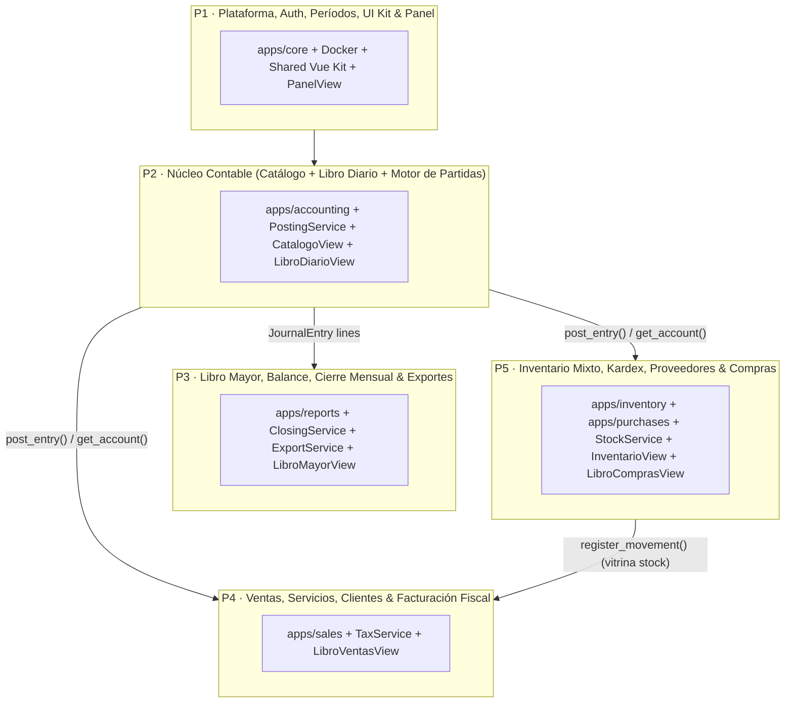
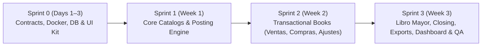

# Implementation Plan & 5-Person Team Division
## Diamond Salón — Atelier Contable

---

## 1. Why Dividing Strictly by View Fails

A naive division ("6 views / 5 people = 1.2 views per person") creates serious bottlenecks in an accounting application:

1. **Views are not equal in size:**
   - **Catálogo de cuentas** is mostly a hierarchical CRUD + search.
   - **Inventario mixto** is two sub-inventories (Vitrina & Cabina), weighted-average cost calculation, Kardex ledger, stock adjustments, and station consumption.
   - **Libro mayor** is a read-only aggregation over journal entries—if the person assigned to *Libro diario* has not built `JournalEntry` yet, the *Libro mayor* developer is 100% blocked.
2. **Tight coupling on the Posting Engine (`Partidas`):**
   - *Ventas*, *Compras*, and *Inventario* all generate journal entries into *Libro diario*. If 4 people invent their own way to insert into `accounting_journal_entry`, double-entry rules will break and merge conflicts on `accounting/models.py` will be constant.
3. **Orphaned cross-cutting foundations:**
   - Authentication, roles, period selector, Docker, shared Vue components (`AppShell`, `DataTable`, `KpiCard`, `Badge`), PDF/Excel exports, and monthly closing belong to *every* view. If nobody owns them, either everyone duplicates them or nobody builds them.
4. **7 views exist in the sidebar, not 6:**
   - The sidebar also includes **Panel (Dashboard)** plus **Cierre periódico**.

---

## 2. Recommended Strategy: Vertical Domain Slices + Shared Posting Engine

Each of the **5 team members** owns a **Full-Stack Domain Module** (Backend Django app + Frontend Vue module + tests) with **zero overlap on model files**, while still having clear primary ownership of specific UI views so grading/accountability stays simple.

### Why Inventario + Compras belong to the same person (P5) and Catálogo + Diario to P2
- In the mock-ups (Vista 1 & Vista 2), **Maira** and **Ferdinand** are credited on *Catálogo* and *Inventario*, **Víctor Flores** on *Ventas* and *Compras*, and **Jose Roberto** on *Libro mayor*.
- Technically, every **Purchase** (`Libro de compras`) directly feeds **Inventory** (`Inventario mixto`) and recalculates weighted-average cost. Giving both to **P5** (or splitting UI vs Backend between two people if preferred—see §4 Option B) eliminates the biggest cross-module transaction in the system.
- Meanwhile, **Catálogo de cuentas** is small, so pairing it with **Libro diario + Posting Engine** in **P2** balances the workload.

---

## 3. Role-by-Role Ownership Matrix (5 Persons)

| Person | Role Title | Primary Views Owned | Backend App(s) Owned | Frontend Paths Owned | Key Services / Deliverables |
|---|---|---|---|---|---|
| **P1** | **Platform, Auth, UI Kit & Dashboard Lead** | **Panel (Dashboard)**, Login, Usuarios, Configuración, Selector de Período | `apps/core` (`User`, `Company`, `FiscalYear`, `AccountingPeriod`, `Employee`, `AuditLog`) | `src/App.vue`, `src/components/ui/*`, `src/stores/auth.js`, `src/stores/period.js`, `src/modules/dashboard/*` | Docker setup, JWT auth + RBAC permissions, Audit middleware, Period service (`get_open_period`), Shared UI components (`DataTable`, `KpiCard`, `Badge`, `Modal`), Dashboard KPIs, Global search (`Ctrl+K`). |
| **P2** | **Accounting Core Lead (Catálogo & Diario)** | **Vista 1 · Catálogo de cuentas** + **Vista 5 · Libro diario** | `apps/accounting` (`Account`, `AccountMapping`, `JournalEntry`, `JournalEntryLine`) | `src/modules/accounting/views/CatalogoCuentasView.vue`, `LibroDiarioView.vue` | Seed NIIF chart of accounts, `PostingService.post_entry()` & `reverse_entry()`, DB triggers for double-entry immutability, Manual journal entry form, Account tree API & dynamic rules modal. |
| **P3** | **Ledger, Financial Reports, Closing & Exports Lead** | **Vista 6 · Libro mayor** + Modal **Cierre periódico** | `apps/reports` + `PeriodBalance` + SQL Views (`v_general_ledger`, `v_trial_balance`) | `src/modules/reports/views/LibroMayorView.vue`, `PeriodCloseModal.vue` | Running-balance ledger query, Trial balance (*Balance de comprobación*), Donut chart & simultaneous summary cards, Monthly IVA liquidation & period lock (`ClosingService`), Reusable PDF/Excel `ExportService` for all books. |
| **P4** | **Sales, Services & Tax Billing Lead** | **Vista 3 · Libro de ventas** + Modals Registrar Venta, Clientes & Servicios | `apps/sales` (`Customer`, `Service`, `DocumentSeries`, `Sale`, `SaleLine`) | `src/modules/sales/views/LibroVentasView.vue`, `SaleFormModal.vue` | Correlative series generator (`FCF`/`CCF`/`NC`/`ND`), `TaxService.split_iva()` (13% inclusive vs additive + 1% retention), Sale atomic workflow (calls `StockService` for vitrina items + `PostingService`), Legal FCF vs CCF sales books. |
| **P5** | **Inventory & Purchasing Lead** | **Vista 2 · Inventario mixto** + **Vista 4 · Libro de compras** | `apps/inventory` + `apps/purchases` (`Product`, `Stock`, `InventoryMovement`, `Adjustment`, `Consumption`, `Supplier`, `Purchase`, `SupplierPayment`) | `src/modules/inventory/*`, `src/modules/purchases/*` | `StockService.register_movement()` with weighted-average cost & Kardex, Stock adjustments & Cabina station consumption, Purchase registration (Vitrina/Cabina destination routing + IVA crédito fiscal), Supplier partial/full payments. |

> **Workload check:** Each person owns **4–6 database tables**, **5–7 API endpoints**, **1–2 main views (plus 2–3 modals)**, and **1 core domain service**.

---

## 4. Alternative Sub-Divisions (If You Prefer Strictly 1 View Each)

If your academic rubric requires each of the 5 members to present **at least one of the 6 core views** on screen:
- **P1** presents **Catálogo de cuentas** + **Panel** (and still builds the shared UI kit + Auth).
- **P2** presents **Libro diario** (and builds `PostingService` + `Account` models).
- **P3** presents **Libro mayor** + **Cierre mensual** + PDF/Excel exports.
- **P4** presents **Libro de ventas** (Customers, Services, FCF/CCF).
- **P5** presents **Inventario mixto** + **Libro de compras** (or P1 takes the *Proveedor payment / Retenciones IVA* sub-views of Compras so P5 focuses on Inventario + Purchase entry).

The code structure in this repository works for **both** arrangements because folders are organized by domain module (`accounting`, `reports`, `sales`, `inventory`, `purchases`, `dashboard`).

---

## 5. Four-Sprint Roadmap (4 Weeks)

### Sprint 0 — Foundation & Contracts (Days 1–3)
- [ ] **All:** Review and sign off [SRS.md](SRS.md), [DB_DESIGN.md](database/DB_DESIGN.md), and the 4 service signatures in `DB_DESIGN.md §6`.
- [ ] **P1:** Verify everyone runs `docker compose up --build`, create initial migrations for `core`, build `AppShell`, `KpiCard`, `DataTable`, `Badge`, `PeriodPicker`.
- [ ] **P2:** Implement `Account`, `AccountMapping`, `JournalEntry`, `JournalEntryLine` models + migrations + seed fixture (`seed.sql` accounts) + `PostingService.post_entry()` stub with unit tests.
- [ ] **P5:** Implement `Supplier`, `Category`, `Location`, `Product`, `Stock`, `InventoryMovement` models + `StockService.register_movement()` stub.
- [ ] **P4:** Implement `Customer`, `Service`, `DocumentSeries` models + `TaxService.split_iva()`.
- [ ] **P3:** Set up `ExportService` base class (PDF/Excel headers) and SQL views migration.

### Sprint 1 — Master Catalogs & Manual Accounting (Week 1)
- [ ] **P1:** Login view, JWT refresh interceptor, role guards, active period store, user & company admin endpoints.
- [ ] **P2:** **Vista 1 · Catálogo de cuentas** complete (tree table, search, filter chips, "+ Nueva cuenta", dynamic debit/credit rules drawer) + **Libro diario** read view.
- [ ] **P5:** **Vista 2 · Inventario mixto** read view (dual Vitrina/Cabina tables, KPI cards, critical stock alert, "+ Agregar producto" modal).
- [ ] **P4:** Customer, Service, and Document Series CRUD modals + FCF/CCF calculator tests.
- [ ] **P3:** Ledger query endpoint (`/api/v1/reports/ledger/`) with opening balance + running balance calculation tested against seed entries.

### Sprint 2 — Operational Transactions & Automatic Posting (Week 2)
- [ ] **P2:** Manual entry form in **Libro diario**, draft → post workflow, entry reversal (`reverse_entry`), DB immutability triggers migration.
- [ ] **P4:** **Vista 3 · Libro de ventas** complete ("+ Registrar venta" modal for services & vitrina products, automatic entry + cost-of-sales entry, void sale).
- [ ] **P5:** **Vista 4 · Libro de compras** complete ("+ Registrar compra" with Vitrina/Cabina destination, automatic stock-in + average cost update + entry, supplier payments) + Inventory adjustments & Cabina consumption modals.
- [ ] **P3:** **Vista 6 · Libro mayor** UI complete (account selector, quick chips, 4 KPI cards, movements table, cash evolution chart, simultaneous summary cards).
- [ ] **P1:** Audit log middleware recording all mutations + notification bell for critical stock.

### Sprint 3 — Closing, Reports, Dashboard & End-to-End QA (Week 3)
- [ ] **P3:** Monthly closing workflow (checklist validation, IVA liquidation entry, `PeriodBalance` snapshot, period lock) + PDF/Excel exports hooked into all 6 views.
- [ ] **P1:** **Panel (Dashboard)** view with live KPIs + global search (`Ctrl+K`).
- [ ] **P2, P4, P5:** Cross-module integration tests (replay the full November 2026 scenario from the mock-ups and verify every KPI matches to the cent).
- [ ] **All:** Bug bash, responsive polish, demo script preparation.

---

## 6. Git Workflow & Zero-Conflict Rules

1. **Branch naming:** `feat/<owner>-<short-description>` (e.g., `feat/p2-chart-of-accounts`, `feat/p4-sales-book`).
2. **File ownership:**
   - Only **P1** edits `backend/apps/core/*` and `frontend/src/components/ui/*`.
   - Only **P2** edits `backend/apps/accounting/*` and `frontend/src/modules/accounting/*`.
   - Only **P3** edits `backend/apps/reports/*` and `frontend/src/modules/reports/*`.
   - Only **P4** edits `backend/apps/sales/*` and `frontend/src/modules/sales/*`.
   - Only **P5** edits `backend/apps/inventory/*`, `backend/apps/purchases/*`, `frontend/src/modules/inventory/*`, and `frontend/src/modules/purchases/*`.
3. **Never write directly to another module's tables:** P4 and P5 never call `JournalEntry.objects.create()`—they always call `PostingService.post_entry()`. P4 never edits `Stock` directly—it calls `StockService.register_movement()`.
4. **Migrations discipline:** Pull `main` before running `makemigrations`. Commit migrations in the same PR as the model change.
5. **Definition of Done (DoD) for every PR:**
   - Runs cleanly in `docker compose up`.
   - Includes pytest tests for service logic (especially IVA, average cost, and double-entry balance).
   - Enforces role permissions and active-period checks.
   - Matches the visual language of the Diamond Salón mock-ups.
