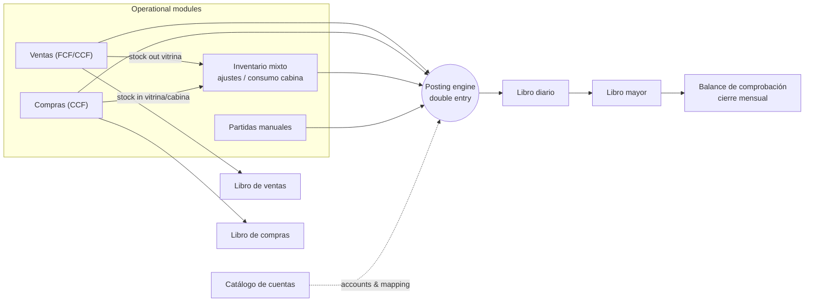

# Software Requirements Specification (SRS)
## Diamond Salón — Atelier Contable (Accounting System)

| Field | Value |
|---|---|
| Version | 1.0 (baseline) |
| Date | 2026-11-04 |
| Standard | Based on IEEE 830 / ISO/IEC/IEEE 29148 |
| Stack | Vue 3 (SPA) · Django 5 + Django REST Framework · PostgreSQL 17 · Docker |
| Status | Draft for team review |

---

## 1. Introduction

### 1.1 Purpose
This document specifies the functional and non-functional requirements of the accounting system for **Diamond Salón**, a beauty salon (atelier) in El Salvador. The salon earns money in two ways: **beauty services** (cabina) and **retail product sales** (vitrina). The SRS is the reference used for design, task assignment, testing and acceptance.

### 1.2 Scope
The system records the salon's sales, purchases and inventory and turns each operation into **double-entry journal entries** automatically. From those entries it produces the legal and management books required under **NIIF para las PYMES** and Salvadoran tax rules (IVA 13 %).

**In scope (v1):**
1. Catálogo de cuentas (chart of accounts) with hierarchical coding.
2. Inventario mixto, kept as two separate inventories: Vitrina (for resale) and Cabina (service supplies).
3. Libro de ventas (sales book), FCF and CCF.
4. Libro de compras (purchase book) with IVA crédito fiscal.
5. Libro diario (journal), with automatic and manual entries.
6. Libro mayor (general ledger) with running balances.
7. Supporting features: users and roles, accounting periods and monthly close, panel/dashboard, PDF/Excel exports, audit trail.

**Out of scope (v1):** electronic invoicing (DTE) transmission to the Ministerio de Hacienda, payroll, fixed-asset depreciation schedules, multi-company, appointment scheduling, full financial statements (Balance General / Estado de Resultados are a *Should/Could*, see RF-REP).

### 1.3 Definitions and acronyms

| Term | Meaning |
|---|---|
| **NIIF PYMES** | International Financial Reporting Standard for Small and Medium-sized Entities. |
| **IVA** | Value-added tax, 13 % in El Salvador. |
| **IVA débito fiscal** | IVA charged on sales; a liability owed to Hacienda. |
| **IVA crédito fiscal** | IVA paid on purchases backed by a CCF; an asset that offsets the débito. |
| **FCF** | *Factura de Consumidor Final*: invoice to a final consumer. The price **includes** IVA. |
| **CCF** | *Comprobante de Crédito Fiscal*: invoice between taxpayers. IVA is shown **separately**. |
| **NC / ND** | Nota de crédito / Nota de débito (adjusts a previous CCF). |
| **NIT / NRC / DUI** | Tax ID / taxpayer registration number / national ID. |
| **Gran contribuyente** | Large taxpayer. Withholds or collects 1 % IVA (retención / percepción). |
| **Partida / asiento** | Journal entry. Each entry has debit (*Debe / cargo*) and credit (*Haber / abono*) lines. |
| **Mayorizar** | To post entries to the ledger accounts. |
| **Vitrina** | Display case: products held **for sale** (retail). |
| **Cabina** | Treatment station: supplies **consumed** while delivering services. |
| **Naturaleza** | Account nature: Deudora (debit balance) or Acreedora (credit balance). |
| **Kardex** | Per-product inventory movement card (entries, exits, balance, cost). |
| **PVP** | *Precio de venta al público*: retail price, IVA included. |

### 1.4 References
- NIIF para las PYMES (IFRS for SMEs), 2015 revision. Sec. 2 (concepts), Sec. 3 (presentation), Sec. 13 (inventories), Sec. 23 (revenue).
- Ley de IVA de El Salvador and the Código Tributario (Art. 141 books of IVA, Art. 107 documents).
- UI mock-ups: Vista 1 (Catálogo), Vista 2 (Inventario mixto), Vista 3 (Libro de ventas), Vista 4 (Libro de compras), Vista 6 (Libro mayor).
- [DB_DESIGN.md](database/DB_DESIGN.md), [IMPLEMENTATION_PLAN.md](IMPLEMENTATION_PLAN.md).

---

## 2. Overall description

### 2.1 Product perspective
The system is a new, standalone web application. Its core idea is a single **posting engine**. Every operational module (sales, purchases, inventory) produces journal entries through that engine, and the books are *views* over the same data. The architecture follows from this.



### 2.2 Product functions (summary)
1. Maintain a hierarchical chart of accounts that follows NIIF PYMES.
2. Register sales of services and products, compute IVA, and issue correlative fiscal document numbers.
3. Register purchases from suppliers, classify each as vitrina, cabina or expense, and compute IVA crédito fiscal.
4. Keep two separate perpetual inventories at weighted-average cost.
5. Automatically generate balanced journal entries for every operation.
6. Show the journal (diario) and ledger (mayor) for any period and account.
7. Close monthly periods: liquidate IVA, snapshot balances, lock the period.
8. Export every book to PDF and Excel.

### 2.3 User classes and roles

| Role | Typical user | Permissions |
|---|---|---|
| **ADMIN** | System owner | Everything, including users, company settings and period reopening. |
| **ACCOUNTANT** (Contador / Auditor líder) | Jose Roberto | Chart of accounts, manual entries, reversals, period close, all books. |
| **AUDITOR** | External auditor | Read-only access to all books, the audit log and exports. |
| **PURCHASING** (Compras & almacén) | Víctor | Suppliers, purchases, supplier payments, inventory adjustments; read inventory. |
| **CASHIER** (Caja / recepción) | Front desk | Register sales and customers, record cabina consumption; read own sales. |
| **READONLY** | Owner / manager | Dashboard and books, read-only. |

### 2.4 Operating environment
- Server: Docker containers (PostgreSQL 17, Django 5.2 on Python 3.13, Vue 3 on Vite / Node 22).
- Client: current versions of Chrome, Edge and Firefox. Desktop first; the layout is usable on tablets ≥ 1024 px.
- Language and locale: Spanish UI, `es-SV`, currency USD, time zone `America/El_Salvador`.

### 2.5 Design and implementation constraints
- C-1 PostgreSQL is the only database. Monetary values use `NUMERIC(14,2)` and are never stored as floats.
- C-2 The REST API is JSON under `/api/v1/` and sends decimals as strings.
- C-3 Django migrations are the source of truth for the schema.
- C-4 Accounting rules follow NIIF PYMES. Tax rules follow Salvadoran IVA law.
- C-5 The whole stack must start with a single `docker compose up`.

### 2.6 Assumptions and dependencies
- A-1 The salon is a single company (single tenant) registered as an IVA taxpayer.
- A-2 Inventory uses the **perpetual system with weighted-average cost**, which NIIF PYMES 13.18 permits.
- A-3 FCF prices include IVA, so base = total / 1.13. CCF prices exclude IVA, so IVA = base × 0.13. Amounts round to 2 decimals, half-up.
- A-4 Fiscal documents are pre-authorized correlatives (series). DTE integration is future work.
- A-5 The mock-up data is illustrative. All KPIs must be computed from real data.

---

## 3. Functional requirements

Priority uses MoSCoW: **M** = Must, **S** = Should, **C** = Could.

### 3.1 General / platform (RF-GEN, RF-SEG)

| ID | Requirement | Pri |
|---|---|---|
| RF-GEN-01 | The app shell shows the sidebar (Panel, Catálogo de cuentas, Inventario, Libro de ventas, Libro de compras, Libro diario, Libro mayor), the active **period selector** ("Periodo: Noviembre 2026"), the logged-in user with their role, and the "Cierre periódico" status. | M |
| RF-GEN-02 | Global search (`Ctrl/⌘+K`) finds accounts by code or name, journal entries by number, and documents (FCF/CCF) by number. | S |
| RF-GEN-03 | All lists support pagination, column sorting, free-text filtering and period/date-range filters. | M |
| RF-GEN-04 | All monetary values display as `$#,##0.00`. Dates display as `dd/mm/yy` in tables and `dd/mm/yyyy` in forms. | M |
| RF-GEN-05 | Notifications (bell) alert the user to critical stock, periods pending close and unbalanced drafts. | C |
| RF-SEG-01 | Users authenticate with username and password (JWT access and refresh tokens). | M |
| RF-SEG-02 | Each API endpoint and menu option enforces the role matrix in §2.3. | M |
| RF-SEG-03 | Every create, update, delete, post, reverse, void, close and export is written to the audit log with user, timestamp and before/after data. | M |
| RF-SEG-04 | ADMIN can manage users and assign roles. | M |
| RF-SEG-05 | Company settings (legal name, NIT, NRC, IVA rate, allow negative stock) are editable by ADMIN. | S |

### 3.2 Catálogo de cuentas (RF-CAT): Vista 1

| ID | Requirement | Pri |
|---|---|---|
| RF-CAT-01 | Show the chart as a hierarchical table with columns Código, Nombre, Clasificación/Nivel, Naturaleza and Acciones. Child accounts are indented under their parent. | M |
| RF-CAT-02 | Coding is decimal and cumulative: level 1 Clase = 1 digit, level 2 Grupo = 2, level 3 Cuenta mayor = 4, level 4 Subcuenta = 6. A child's code must start with its parent's code. | M |
| RF-CAT-03 | Create an account ("+ Nueva cuenta") with code, name, parent, type, nature, classification label, NIIF reference, vitrina/cabina tag, and the rules for when it is debited and credited. Level, type and nature are suggested from the parent. | M |
| RF-CAT-04 | Only leaf accounts (`accepts_entries = true`) can receive journal lines. An account that has movements cannot become a parent. | M |
| RF-CAT-05 | Edit name, classification and descriptions. Code, nature and parent are **locked** once the account has movements. | M |
| RF-CAT-06 | Deactivate accounts that have no balance in the open period. Accounts are never physically deleted once used. | M |
| RF-CAT-07 | Instant search by code or name ("Buscar: inventario, caja, IVA…") plus filter chips by class showing counts: Todos, Activos, Pasivos, Patrimonio, Costos/Gastos, Ingresos. | M |
| RF-CAT-08 | The (i) action opens the account detail: its debit and credit rules, current balance and a link to its Libro mayor. | M |
| RF-CAT-09 | Show the vitrina and cabina badges on inventory, cost and income accounts. | S |
| RF-CAT-10 | Export the chart ("Exportar NIIF") to Excel and PDF. | S |
| RF-CAT-11 | Ship a pre-loaded base chart (see [seed.sql](database/seed.sql)) and an editable **account mapping** (event → account) that the posting engine uses. | M |
| RF-CAT-12 | Show "Estado del plan: BALANCEADO" when total debit balances equal total credit balances for the period. | S |

### 3.3 Inventario mixto (RF-INV): Vista 2

| ID | Requirement | Pri |
|---|---|---|
| RF-INV-01 | Each product belongs to exactly one regime: **VITRINA** (for sale, account 110501) or **CABINA** (service supply, account 110502). | M |
| RF-INV-02 | The view shows two separate panels. Vitrina (wine color) lists Descripción, Existencia, PVP unitario and Clasificación "Venta". Cabina (black/gold) lists Insumo, Existencia, Ubicación/Estación and Clasificación "Servicio". Each panel has its own filter and shows its ledger account. | M |
| RF-INV-03 | KPI cards: vitrina stock (units/items and valuation at **cost**, with PVP shown as reference), cabina stock (units and cost), and a **critical stock** alert listing products at or below minimum stock. | M |
| RF-INV-04 | "+ Agregar producto": SKU, barcode, name, brand, presentation, category, regime, unit of measure, PVP (vitrina only, required), minimum stock, default supplier. | M |
| RF-INV-05 | Stock is tracked per location (Vitrina, Cabina 1, Cabina 2, Bodega general). | M |
| RF-INV-06 | Every stock change creates an immutable **Kardex** movement (type, qty, unit cost, balance qty, balance average cost, source document). | M |
| RF-INV-07 | Purchases recompute the **weighted-average cost**. Outgoing movements are valued at the current average cost. | M |
| RF-INV-08 | "Ajuste de stock" (physical count, damage, expiry, theft). Adjustments generate a journal entry against *Faltantes* (420102) or *Sobrantes* (5201). | M |
| RF-INV-09 | **Cabina consumption**: record supplies consumed per station and day, optionally linked to a service sale or a stylist. This generates the entry Dr 410201 Costo de servicios / Cr 110502. | M |
| RF-INV-10 | Optional "recipes" (service → supplies) that suggest consumption automatically when a service is sold. | C |
| RF-INV-11 | Stock cannot go negative unless the company setting allows it. | M |
| RF-INV-12 | Transfers between locations, and reclassification between regimes with its corresponding entry. | S |
| RF-INV-13 | Kardex report per product and period, exportable. | S |

### 3.4 Libro de ventas (RF-VEN): Vista 3

| ID | Requirement | Pri |
|---|---|---|
| RF-VEN-01 | "+ Registrar venta": date, document type (FCF or CCF), customer (default *Consumidor final*), payment method (cash, card, transfer, credit), and lines of type **SERVICE** (from the services catalog) or **PRODUCT** (vitrina products only). | M |
| RF-VEN-02 | The document number is taken automatically from the active authorized series ("FCF-0012"). Numbers are unique and have no gaps. | M |
| RF-VEN-03 | IVA calculation: for FCF, base = total / 1.13; for CCF, IVA = base × 13 %. A large-taxpayer customer on a CCF triggers 1 % IVA withholding. | M |
| RF-VEN-04 | A CCF requires a taxpayer customer with NIT/DUI and NRC. | M |
| RF-VEN-05 | On save the system atomically: (a) creates the sale; (b) posts the entry, with SERVICE lines going to 5101 and PRODUCT lines to 5102, IVA to 2107, and the debit to Caja, Bancos or Clientes; (c) for products, creates SALE stock movements and the cost entry Dr 410101 / Cr 110501. | M |
| RF-VEN-06 | The table shows Fecha, Documento, Cliente, Concepto (with CABINA/VITRINA badge), Gravado, IVA and Total, plus period totals that show "Sumas iguales comprobadas". | M |
| RF-VEN-07 | Filters: date range, category tabs with counts (Todos, Servicio, Venta de producto), document type, and text search by customer or document. | M |
| RF-VEN-08 | KPI cards: gross sales, taxable base (% of total), IVA débito fiscal, documents issued (count and range). | M |
| RF-VEN-09 | Summary cards: Servicios en salón (cabina) and Venta retail (vitrina), each with amount, % and count. | S |
| RF-VEN-10 | Void a sale (with a reason). This creates the reversal entry and returns stock. A void is only possible in an open period. Issued documents are never deleted. | M |
| RF-VEN-11 | Credit and debit notes (NC/ND) referencing a CCF. | S |
| RF-VEN-12 | Legal formats: *Libro de ventas a consumidor final* (daily summary by FCF range) and *Libro de ventas a contribuyentes* (one row per CCF), exportable ("Descargar reporte mensual"), plus a print view. | M |
| RF-VEN-13 | Customer and services catalogs (CRUD). | M |

### 3.5 Libro de compras (RF-COM): Vista 4

| ID | Requirement | Pri |
|---|---|---|
| RF-COM-01 | Supplier CRUD: name, NIT (unique), NRC, taxpayer category, brands/description, contact. | M |
| RF-COM-02 | "+ Registrar compra": supplier, document type (CCF, Factura, NC, ND, Import, Sujeto excluido), number, date, **destination** (Vitrina, Cabina, Mixed, Expense), payment condition (cash or credit, with due date), and lines with product (or expense account), location, quantity and unit cost. | M |
| RF-COM-03 | IVA crédito fiscal is computed only for CCF (13 % of base). 1 % perception from large suppliers is recorded. Supplier + type + number must be unique. | M |
| RF-COM-04 | On save the system atomically: (a) creates PURCHASE stock movements into the inventory matching the destination and updates the average cost; (b) posts Dr 110501/110502 (or the expense account), Dr 110601 IVA crédito, Cr Caja or 210101 Proveedores. | M |
| RF-COM-05 | Table: Fecha, Documento, Proveedor (with brands), Destino badge, Gravado, IVA, Total, with period totals. | M |
| RF-COM-06 | Filters: period, supplier, destination. Export and print. | M |
| RF-COM-07 | KPIs: total purchases, taxable base, IVA crédito fiscal, active suppliers. | M |
| RF-COM-08 | "Distribución por destino" chart: vitrina vs cabina amount and %. | S |
| RF-COM-09 | Supplier payments (partial or total) against a purchase. These update the payment status and post Dr Proveedores / Cr Caja/Bancos. | M |
| RF-COM-10 | "Ver retenciones IVA": report of perceived and withheld IVA for the period. | S |
| RF-COM-11 | Void a purchase (with a reason). This creates the reversal entry and the reversal stock movements, and is blocked if the stock was already consumed. | M |
| RF-COM-12 | Legal format of the *Libro de compras* (Art. 141 CT) exportable to Excel and PDF. | M |

### 3.6 Libro diario (RF-DIA): no mock-up yet

| ID | Requirement | Pri |
|---|---|---|
| RF-DIA-01 | Chronological list of posted entries: N.º de partida, fecha, concepto, tipo/origen (badge: Venta, Compra, Inventario, Manual, Apertura, Cierre, Reversión), and lines (código, cuenta, Debe, Haber). Each entry shows its subtotal; period totals show "Sumas iguales". | M |
| RF-DIA-02 | Manual entry form (ACCOUNTANT): date, description, and N lines (leaf account, description, debit or credit). The difference shows live and the form cannot be posted until debit = credit > 0. | M |
| RF-DIA-03 | Drafts can be saved, edited and deleted. **Posting** assigns the next sequential entry number in the period and makes the entry immutable. | M |
| RF-DIA-04 | Posted entries can only be corrected through a **reversal entry**. The original is marked "REVERSED" and linked to its reversal. | M |
| RF-DIA-05 | Opening entry (Apertura) for the first period, or carried forward from the previous close. | M |
| RF-DIA-06 | Every automatic entry links to its source document (click-through to the sale, purchase or adjustment). | M |
| RF-DIA-07 | Filters: period, date range, type, account, text. Export to PDF and Excel. | M |

### 3.7 Libro mayor (RF-MAY): Vista 6

| ID | Requirement | Pri |
|---|---|---|
| RF-MAY-01 | Account selector with search (code, name, nature and classification) and quick chips for key accounts (110101, 110501, 2107, 5101, 5102). | M |
| RF-MAY-02 | Period or date-range selector. | M |
| RF-MAY-03 | KPI cards: Saldo inicial (balance before the range), Total cargos (Debe) with count, Total abonos (Haber) with count, Saldo final with nature. | M |
| RF-MAY-04 | Movements table: Fecha, Concepto/referencia (with origin badge and document reference), Ref. partida (link to the diario), Cargos, Abonos and Saldo resultante (running balance signed by the account's nature). The first row is the opening balance. Footer shows totals. | M |
| RF-MAY-05 | Mayorization is **automatic**: posting an entry updates the ledger immediately. The "Mayorizar asientos" button only re-validates and refreshes the view, and no manual step is needed. | M |
| RF-MAY-06 | Verification badge "Sumas iguales verificadas: OK" when the trial balance of the period is balanced. | M |
| RF-MAY-07 | Balance-evolution chart (donut or line) for the selected account: opening, inflows, outflows. | S |
| RF-MAY-08 | "Resumen mayorizado simultáneo": cards with the current balance of related key accounts. | S |
| RF-MAY-09 | Export the ledger of one or all accounts (PDF and Excel). | M |
| RF-MAY-10 | Balance de comprobación (trial balance) by period. | M |

### 3.8 Period close (RF-CIE)

| ID | Requirement | Pri |
|---|---|---|
| RF-CIE-01 | Monthly periods are generated per fiscal year. Exactly one period is the "active" working period in the UI. | M |
| RF-CIE-02 | Pre-close checklist: no draft entries, trial balance balanced, no sales or purchases without an entry, inventory valuation equals the balances of 110501 and 110502. | M |
| RF-CIE-03 | IVA liquidation entry: Dr 2107 IVA débito / Cr 110601 IVA crédito / Cr 210801 IVA por pagar (or the reverse when there is a remainder in the salon's favor). | M |
| RF-CIE-04 | Closing snapshots each account's balance (`accounting_period_balance`) and locks the period. No inserts, updates or voids are allowed after that. | M |
| RF-CIE-05 | ADMIN can reopen the last closed period. This is audited and requires a reason. | S |
| RF-CIE-06 | Annual close: transfer income and expense balances to 310501 Resultados. | C |

### 3.9 Panel and reports (RF-PAN, RF-REP)

| ID | Requirement | Pri |
|---|---|---|
| RF-PAN-01 | Dashboard for the active period: sales (services vs products), purchases, IVA to pay (débito − crédito), cash balance, critical stock, last entries. | S |
| RF-REP-01 | A common export service gives every book the same PDF and Excel format (company header, period, page numbers, totals). | M |
| RF-REP-02 | Estado de resultados (income statement) for the period. | C |
| RF-REP-03 | Balance general (statement of financial position). | C |

---

## 4. Business rules

| ID | Rule |
|---|---|
| RN-01 | **Double entry**: every posted entry has ≥ 2 lines and Σ Debe = Σ Haber > 0. Each line is either debit or credit, never both. |
| RN-02 | Posted entries are immutable. Corrections are made by reversal only. Drafts are not part of any book. |
| RN-03 | Entries can only be posted in an **open** period, and the entry date must fall inside that period. |
| RN-04 | Only active leaf accounts receive movements. |
| RN-05 | Balance sign follows the account's nature: Deudora balance = Debe − Haber; Acreedora balance = Haber − Debe. |
| RN-06 | IVA rate comes from company settings (13 %). FCF prices include IVA; CCF prices exclude it. Round half-up to 2 decimals on each line, and compute document totals as the sum of the lines. |
| RN-07 | **Vitrina and cabina never mix**: a vitrina product cannot be consumed in cabina, and a cabina supply cannot be sold, unless it is reclassified first (RF-INV-12). |
| RN-08 | Inventory is valued at weighted-average cost (NIIF PYMES Sec. 13). PVP is informational only. |
| RN-09 | Fiscal document numbers are correlative per series and unique. Issued documents can be voided but never deleted. |
| RN-10 | A purchase document is unique per (supplier, type, number). |
| RN-11 | Each automatic posting and its source operation are saved in **one DB transaction**: either both persist or neither does. |
| RN-12 | Posting rules use the configurable account mapping (§5). Account codes are never hard-coded. |
| RN-13 | The ledger balance of 110501 and 110502 must equal the inventory valuation per Kardex. Any difference blocks the period close. |

---

## 5. Automatic posting matrix

Account codes reference the proposed chart in [seed.sql](database/seed.sql). The mapping key (in brackets) is what code uses.

| Event | Debit (Debe) | Credit (Haber) |
|---|---|---|
| Service sale, FCF cash ($25.00) | 110101 Caja [CASH] 25.00 | 5101 Ingresos servicios [INCOME_SERVICES] 22.12 · 2107 IVA débito [IVA_DEBIT] 2.88 |
| Product sale, FCF cash ($12.00) | 110101 Caja 12.00 | 5102 Ingresos productos [INCOME_PRODUCTS] 10.62 · 2107 IVA débito 1.38 |
| └ cost of that product sale | 410101 Costo de venta [COST_OF_SALES] (avg cost) | 110501 Inventario vitrina [INVENTORY_VITRINA] |
| Sale by card / transfer / credit | 110102 Bancos [BANK] / 110301 Clientes [ACCOUNTS_RECEIVABLE] | (same as above) |
| Vitrina purchase, CCF credit ($150 + IVA) | 110501 Inventario vitrina 150.00 · 110601 IVA crédito [IVA_CREDIT] 19.50 | 210101 Proveedores [ACCOUNTS_PAYABLE] 169.50 |
| Cabina purchase, CCF ($90 + IVA) | 110502 Insumos cabina [INVENTORY_CABINA] 90.00 · 110601 IVA crédito 11.70 | 210101 Proveedores / 110101 Caja 101.70 |
| Supplier payment | 210101 Proveedores | 110101 Caja / 110102 Bancos |
| Cabina consumption | 410201 Costo servicios atelier [SERVICE_SUPPLY_COST] | 110502 Insumos cabina |
| Negative adjustment | 420102 Faltantes [INVENTORY_SHORTAGE] | 110501 / 110502 |
| Positive adjustment | 110501 / 110502 | 5201 Sobrantes [INVENTORY_SURPLUS] |
| Monthly IVA liquidation | 2107 IVA débito | 110601 IVA crédito · 210801 IVA por pagar [IVA_PAYABLE] |
| Void / correction | Reversal: mirror image of the original entry | |

---

## 6. Non-functional requirements

| ID | Category | Requirement |
|---|---|---|
| RNF-01 | Performance | Book views (≤ 5,000 lines per period) load in < 2 s. Saving a sale or purchase with its entry takes < 1 s (p95). |
| RNF-02 | Integrity | Accounting rules RN-01 to RN-04 are enforced in the service layer **and** by DB constraints/triggers. |
| RNF-03 | Precision | All money uses `Decimal` / `NUMERIC`. Floats are never used in backend or frontend calculations. The frontend only displays values; totals come from the API. |
| RNF-04 | Security | Passwords are hashed (Django PBKDF2). JWT expires after 30 min. Role checks run on the server. HTTPS in production. Secrets come from environment variables. OWASP Top-10 is considered (CSRF, SQL injection via ORM, XSS via Vue escaping). |
| RNF-05 | Auditability | The audit log is append-only. Every entry stores created_by, posted_by and timestamps. |
| RNF-06 | Usability | Spanish UI following the mock-ups' visual identity (wine #6b1a24, gold, black). Clear vitrina and cabina badges. Validation messages in Spanish. Main flows take ≤ 3 clicks. |
| RNF-07 | Availability / backup | Daily `pg_dump` backup with 30-day retention (production). |
| RNF-08 | Maintainability | Modular Django apps per domain. ≥ 70 % test coverage on the service layer (posting engine, IVA calculation, inventory cost). PEP 8 + ESLint. PRs require review. |
| RNF-09 | Portability | `docker compose up` starts DB, API and SPA on any OS that has Docker. |
| RNF-10 | Compatibility | Latest 2 versions of Chrome, Edge and Firefox. Minimum 1024 px width. |
| RNF-11 | Traceability | Every amount in a book can be traced to its journal entry and source document in ≤ 2 clicks. |

---

## 7. External interface requirements

### 7.1 User interface
The 7 screens of §3 plus Login, Users (admin), Company settings and Period close. A shared component library provides: `AppShell`, `KpiCard`, `DataTable` (sortable, with totals footer), `MoneyCell`, `Badge` (VITRINA/CABINA/EGRESO…), `PeriodPicker`, `DateRangePicker`, `SearchInput`, `ExportButton`, `ConfirmDialog`, `FormModal`.

### 7.2 API (REST, JSON), main resources

| Module | Endpoints (prefix `/api/v1/`) |
|---|---|
| core | `auth/token/`, `users/`, `company/`, `periods/`, `periods/{id}/close/`, `audit-log/` |
| accounting | `accounts/` (`?tree=1`), `account-mappings/`, `journal-entries/`, `journal-entries/{id}/post/`, `journal-entries/{id}/reverse/` |
| reports | `ledger/?account=&from=&to=`, `trial-balance/?period=`, `exports/{book}/?format=pdf\|xlsx` |
| sales | `customers/`, `services/`, `document-series/`, `sales/`, `sales/{id}/void/`, `sales-book/?period=&type=` |
| inventory | `products/`, `locations/`, `stock/`, `movements/` (kardex), `adjustments/`, `consumptions/` |
| purchases | `suppliers/`, `purchases/`, `purchases/{id}/void/`, `supplier-payments/`, `purchase-book/?period=` |

### 7.3 Software interfaces
PostgreSQL 17 (psycopg 3). PDF via ReportLab, Excel via openpyxl. Future: Hacienda DTE API.

---

## 8. Traceability: views → requirements → owners

| View | Requirements | Backend module | Owner |
|---|---|---|---|
| Shell, Panel, login | RF-GEN, RF-SEG, RF-PAN | core | P1 |
| Catálogo de cuentas | RF-CAT | accounting | P2 |
| Libro diario | RF-DIA | accounting | P2 |
| Libro mayor, close, exports | RF-MAY, RF-CIE, RF-REP | reports | P3 |
| Libro de ventas | RF-VEN | sales | P4 |
| Inventario mixto | RF-INV | inventory | P5 |
| Libro de compras | RF-COM | purchases | P5 |

---

## 9. Open issues found in the mock-ups (decide before Sprint 1)

| # | Finding | Proposal |
|---|---|---|
| OI-1 | Catálogo: "21 PASIVO" and "51 INGRESOS" are labeled "Clase · 2 dígitos", which conflicts with the rule that classes have 1 digit. | Use 2 PASIVO / 21 Pasivo corriente and 5 INGRESOS / 51 Ingresos ordinarios. |
| OI-2 | Catálogo has no Patrimonio, Costos/Gastos, IVA crédito fiscal or Proveedores accounts (the "GASTOS (0)" chip is empty), but purchases and cabina consumption need them. | Add classes 3 and 4 and accounts 1106, 2101, 2108, 41xx and 42xx (see seed). |
| OI-3 | Inventario view shows the cabina account as **5202-04** (class 5 = Ingresos) and vitrina as "1105-01", while the catalog uses 110502 / 110501. | Use 110502 and the 6-digit format everywhere. |
| OI-4 | Inventario: vitrina valued at "$1,420.00 PVP". NIIF PYMES Sec. 13 requires cost. The subtotal "$946.50 valuado" does not match the listed rows (18×12 + 11×22 + 7×18 + 25×6.5 = $746.50). "42 items" vs 61 units. "4 estaciones" but 3 are shown. | Show value **at cost** as the main figure and PVP as a secondary reference. Compute every KPI. |
| OI-5 | Libro de compras says cabina purchases are "charged directly to Costo de servicios", but the inventory view tracks cabina stock. | Use the perpetual approach: purchase → 110502, consumption → 410201 (RF-INV-09). |
| OI-6 | Libro de ventas labels IVA débito as "Crédito por liquidar" and "Impuesto retenido a enterar". | Relabel to "Por pagar a Hacienda". |
| OI-7 | Libro de ventas mixes the formats. Salvadoran law requires separate books for consumidor final (FCF) and contribuyentes (CCF). | Two tabs/exports (RF-VEN-12). |
| OI-8 | Libro mayor: the Insumos Pro payment of $101.70 is labeled "pago parcial", but it equals the full CCF-4522 (90 + 11.70). The "+7.40 % s/inicial" KPI has no defined formula. | Compute payment status. Define the KPI as (Σ cargos / saldo inicial) or remove it. |
| OI-9 | Libro diario and Panel have no mock-up yet. | Owners P2 and P1 design them in Sprint 1 using the shared components. |
| OI-10 | Electronic invoicing (DTE) is mandatory for many Salvadoran taxpayers. | Confirm with the professor/client whether it is out of scope for v1. |

---

## Appendix A: Acceptance test examples (Gherkin)

```gherkin
Scenario: Product sale generates income, IVA and cost entries
  Given product "Champú nutritivo 300ml" (VITRINA) with stock 18 and average cost 7.00
  When the cashier registers FCF for 1 unit at PVP 12.00 paid in cash
  Then sale FCF-0013 is created with taxable 10.62, IVA 1.38, total 12.00
  And a POSTED entry has Dr 110101 12.00, Cr 5102 10.62, Cr 2107 1.38, Dr 410101 7.00, Cr 110501 7.00
  And the stock becomes 17

Scenario: Unbalanced manual entry cannot be posted
  Given a draft entry with Debe 10.00 and Haber 9.00
  When the accountant tries to post it
  Then the system rejects it with "La partida no está cuadrada (diferencia $1.00)"

Scenario: Closed period is locked
  Given period October 2026 is CLOSED
  When any user registers a purchase dated 2026-10-15
  Then the system rejects it with "El período 10/2026 está cerrado"
```
