# Database Design: Diamond Salón Accounting System

**DBMS:** PostgreSQL 17 · **ORM:** Django 5.2 · **Reference DDL:** [schema.sql](schema.sql) · **Seed:** [seed.sql](seed.sql)

> Django migrations are the source of truth. `schema.sql` is the agreed design that each owner turns into Django models. Table names follow Django's `<app_label>_<model>` convention, so a model `Account` in app `accounting` maps to `accounting_account`. Triggers and views go in `migrations.RunSQL`.

---

## 1. Design principles

1. **One journal for everything.** Sales, purchases, adjustments, consumptions and manual entries all create rows in `accounting_journal_entry` and `accounting_journal_entry_line`. Libro diario and Libro mayor are **queries**, not separate tables.
2. **Books are views.** `accounting_v_journal_book`, `accounting_v_general_ledger`, `accounting_v_trial_balance`, `sales_v_sales_book` and `purchases_v_purchase_book` read the transactional tables.
3. **Immutability.** Posted entries and Kardex movements are never updated or deleted. Corrections use reversal entries and opposite movements. DB triggers enforce this.
4. **Money is `NUMERIC(14,2)`**, costs are `NUMERIC(14,4)` and quantities are `NUMERIC(12,3)` (liters and ml are fractional).
5. **Enums are `varchar` + `CHECK`**, which maps 1:1 to Django `TextChoices`.
6. **Configurable posting.** `accounting_account_mapping` maps business events (e.g. `IVA_DEBIT`) to accounts, so Python code never contains account codes.
7. **Vitrina and cabina separation** is enforced at the product level (`inventory_type`) and by the inventory account each product points to.

---

## 2. Entity-relationship diagram

```mermaid
erDiagram
    core_user ||--o{ accounting_journal_entry : creates
    core_fiscal_year ||--|{ core_accounting_period : has
    core_accounting_period ||--o{ accounting_journal_entry : contains
    core_accounting_period ||--o{ accounting_period_balance : snapshots

    accounting_account ||--o{ accounting_account : "parent of"
    accounting_account ||--o{ accounting_journal_entry_line : "receives"
    accounting_account ||--o{ accounting_account_mapping : "mapped by"
    accounting_account ||--o{ accounting_period_balance : has
    accounting_journal_entry ||--|{ accounting_journal_entry_line : has
    accounting_journal_entry |o--o| accounting_journal_entry : "reversal of"

    inventory_category ||--o{ inventory_product : groups
    inventory_product }o--|| accounting_account : "valued in"
    inventory_product ||--o{ inventory_stock : "stock at"
    inventory_location ||--o{ inventory_stock : holds
    inventory_product ||--o{ inventory_movement : kardex
    inventory_location ||--o{ inventory_movement : at
    inventory_movement }o--o| accounting_journal_entry : "posted in"
    inventory_adjustment ||--o{ inventory_movement : "source of"
    inventory_consumption ||--o{ inventory_movement : "source of"

    sales_customer ||--o{ sales_sale : buys
    sales_document_series ||--o{ sales_sale : numbers
    sales_sale ||--|{ sales_sale_line : has
    sales_service ||--o{ sales_sale_line : "sold as"
    inventory_product ||--o{ sales_sale_line : "sold as"
    sales_service ||--o{ sales_service_supply : recipe
    sales_sale |o--|| accounting_journal_entry : "posted in"
    core_employee ||--o{ sales_sale : attends

    purchases_supplier ||--o{ purchases_purchase : issues
    purchases_purchase ||--|{ purchases_purchase_line : has
    inventory_product ||--o{ purchases_purchase_line : "bought as"
    purchases_purchase ||--o{ purchases_supplier_payment : "paid by"
    purchases_purchase |o--|| accounting_journal_entry : "posted in"
    purchases_supplier_payment |o--|| accounting_journal_entry : "posted in"
```



---

## 3. Tables by module (owner)

### 3.1 `core` (P1)

| Table | Purpose | Key columns / constraints |
|---|---|---|
| `core_company` | Single-row company settings | `id = 1` check, `nit`, `nrc`, `iva_rate` (0.13), `allow_negative_stock` |
| `core_user` | Custom Django user (`AUTH_USER_MODEL`) | `role` ∈ ADMIN, ACCOUNTANT, AUDITOR, PURCHASING, CASHIER, READONLY |
| `core_employee` | Stylists / staff (not system users) | `position` |
| `core_fiscal_year` | Fiscal year | `year` unique |
| `core_accounting_period` | Monthly period | UNIQUE(`year`,`month`), `status` OPEN/CLOSED, `is_active`, `is_hidden`, `closed_by_id` |
| `core_audit_log` | Append-only audit trail | `action`, `table_name`, `record_id`, `before_data`/`after_data` JSONB |

### 3.2 `accounting` (P2)

| Table | Purpose | Key columns / constraints |
|---|---|---|
| `accounting_account` | Chart of accounts (Vista 1) | `code` unique numeric, self-FK `parent_id`, `level` 1–6, `account_type`, `nature` DEBIT/CREDIT, `accepts_entries` (leaf), `inventory_type` VITRINA/CABINA, `debit_rule`/`credit_rule` |
| `accounting_account_mapping` | Event → account for the posting engine | PK `key` (CASH, IVA_DEBIT, INCOME_SERVICES…) |
| `accounting_journal_entry` | Partida (header) | `entry_number` unique per period (assigned on post), `entry_type`, `source_app`+`source_id`, `status` DRAFT/POSTED/REVERSED, `reversal_of_id` unique, totals check |
| `accounting_journal_entry_line` | Debe/Haber lines | CHECK exactly one of `debit`/`credit` > 0, UNIQUE(`entry_id`,`line_no`) |
| `accounting_period_balance` | Balance snapshot at close (P3) | UNIQUE(`account_id`,`period_id`) |

### 3.3 `inventory` (P5)

| Table | Purpose | Key columns / constraints |
|---|---|---|
| `inventory_category` | Product categories per regime | UNIQUE(`name`,`inventory_type`) |
| `inventory_location` | Vitrina, Cabina 1, Cabina 2, Bodega | `location_type` |
| `inventory_product` | Products and supplies (Vista 2) | `sku` unique, `inventory_type`, `account_id` (110501/110502), `sale_price` required **only** for vitrina (CHECKs), `average_cost`, `min_stock` |
| `inventory_stock` | Current qty per product/location (cache) | PK(`product_id`,`location_id`), `quantity >= 0` |
| `inventory_movement` | Kardex, append-only | `movement_type`, `direction` ±1, `quantity > 0`, `unit_cost`, `balance_quantity`, `balance_avg_cost`, `source_app`/`source_id`, `journal_entry_id` |
| `inventory_adjustment` | Stock-adjustment header | `reason`, `journal_entry_id` |
| `inventory_consumption` | Cabina consumption header | `location_id`, `employee_id`, optional `sale_id` |

### 3.4 `sales` (P4)

| Table | Purpose | Key columns / constraints |
|---|---|---|
| `sales_customer` | Customers ("Consumidor final" is the generic one) | `customer_type`; TAXPAYER requires `nrc` and `document_number` |
| `sales_service` | Beauty services catalog | `price` (incl. IVA), `income_account_id` (5101) |
| `sales_service_supply` | Optional recipe service → supplies | UNIQUE(`service_id`,`product_id`) |
| `sales_document_series` | Authorized correlatives FCF/CCF/NC/ND | one active series per type, `next_number` within range |
| `sales_sale` | Sales document (Vista 3) | UNIQUE(`doc_type`,`doc_number`), amount breakdown + CHECK `total = taxable + exempt + non_subject + iva − withheld`, `status` ISSUED/VOIDED, `journal_entry_id` |
| `sales_sale_line` | Lines | `line_type` SERVICE (→ `service_id`) or PRODUCT (→ `product_id`), CHECK `total = taxable + iva`, `unit_cost` snapshot |

### 3.5 `purchases` (P5)

| Table | Purpose | Key columns / constraints |
|---|---|---|
| `purchases_supplier` | Suppliers | `nit` unique, `taxpayer_category` (LARGE → 1 % perception) |
| `purchases_purchase` | Purchase document (Vista 4) | UNIQUE(`supplier_id`,`doc_type`,`doc_number`), `destination`, `iva_credit`, `iva_perceived`, `payment_status`, CHECK on total |
| `purchases_purchase_line` | Lines | exactly one of `product_id` / `expense_account_id`; `location_id` required for products |
| `purchases_supplier_payment` | Payments to suppliers | `amount > 0`, `cash_account_id`, `journal_entry_id` |

---

## 4. Integrity enforced in the database

| Mechanism | Rule |
|---|---|
| `trg_journal_entry_guard` | Entries are inserted as DRAFT only. DRAFT → POSTED requires an open period, a date inside the period, ≥ 2 lines and Σ debit = Σ credit > 0, and fills in the totals. POSTED → REVERSED is the only allowed change. Posted entries cannot be deleted. |
| `trg_journal_line_guard` | Lines can only change while the entry is DRAFT, and only on active leaf accounts. |
| `trg_inventory_movement_append_only` | Kardex rows cannot be updated or deleted. |
| CHECK constraints | Debit XOR credit, non-negative amounts, document total formulas, vitrina must have PVP, cabina must not, TAXPAYER needs NRC. |
| UNIQUE constraints | Account code, entry number per period, document numbers, supplier documents, SKU. |

The service layer validates the same rules first, so users get friendly Spanish messages. The DB is the last line of defense.

---

## 5. Key queries

**Libro mayor for an account and range** (opening balance + movements):

```sql
-- opening balance
SELECT COALESCE(SUM(CASE WHEN a.nature='DEBIT' THEN l.debit-l.credit ELSE l.credit-l.debit END),0)
FROM accounting_journal_entry_line l
JOIN accounting_journal_entry e ON e.id = l.entry_id
JOIN accounting_account a ON a.id = l.account_id
WHERE l.account_id = :account AND e.status IN ('POSTED','REVERSED') AND e.entry_date < :date_from;

-- movements with running balance (add the opening balance in the API)
SELECT entry_date, entry_number, concept, debit, credit,
       SUM(CASE WHEN nature='DEBIT' THEN debit-credit ELSE credit-debit END)
         OVER (ORDER BY entry_date, entry_number, entry_id ROWS UNBOUNDED PRECEDING) AS running
FROM accounting_v_general_ledger
WHERE account_id = :account AND entry_date BETWEEN :date_from AND :date_to;
```

**Balance of a parent account** (e.g. 1105 Inventarios) is the sum of its descendants by code prefix, which `ix_account_code_prefix` speeds up:

```sql
SELECT SUM(l.debit - l.credit) FROM accounting_journal_entry_line l
JOIN accounting_account a ON a.id = l.account_id
JOIN accounting_journal_entry e ON e.id = l.entry_id
WHERE a.code LIKE '1105%' AND e.status IN ('POSTED','REVERSED');
```

---

## 6. Service-layer contracts (agree in Sprint 0)

These functions are the **only** way modules write to tables owned by another person.

```python
# apps/accounting/services/posting.py  (owner P2)
def post_entry(*, entry_date, description, entry_type, lines: list[LineDTO],
               source_app: str | None = None, source_id: int | None = None, user) -> JournalEntry:
    """Validates and creates a POSTED entry atomically. LineDTO = (account_key|account_id, debit, credit, description).
    Raises UnbalancedEntryError, ClosedPeriodError, InvalidAccountError."""

def reverse_entry(entry: JournalEntry, *, reason: str, user) -> JournalEntry: ...
def get_account(key: str) -> Account:  # from accounting_account_mapping

# apps/core/services/periods.py  (owner P1)
def get_open_period(date) -> AccountingPeriod:  # raises ClosedPeriodError

# apps/inventory/services/stock.py  (owner P5)
def register_movement(*, product, location, movement_type, quantity, unit_cost=None,
                      movement_date, source_app, source_id, user) -> InventoryMovement:
    """Updates stock + weighted-average cost; for outgoing moves returns the cost used (unit_cost=None)."""

# apps/sales/services/tax.py  (owner P4, reused by P5)
def split_iva(amount, *, price_includes_iva: bool, rate) -> tuple[Decimal, Decimal]: ...
```

---

## 7. Django implementation notes

- Use `models.DecimalField(max_digits=14, decimal_places=2)` for money. Never `FloatField`.
- Use `on_delete=models.PROTECT` for every FK that has `ON DELETE RESTRICT`.
- Put CHECK and UNIQUE constraints in `Meta.constraints` (`CheckConstraint`, `UniqueConstraint(condition=...)`).
- Wrap operations in `transaction.atomic()` and use `select_for_update()` on `sales_document_series` and `inventory_product` / `inventory_stock` to avoid duplicate numbers and races on cost.
- Add triggers and views in a dedicated migration per app (`RunSQL(sql, reverse_sql)`).
- Seed the chart of accounts, mapping, locations and series with a data migration or the fixture `apps/accounting/fixtures/initial_chart.json`.
